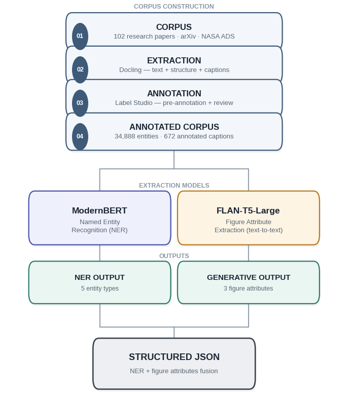
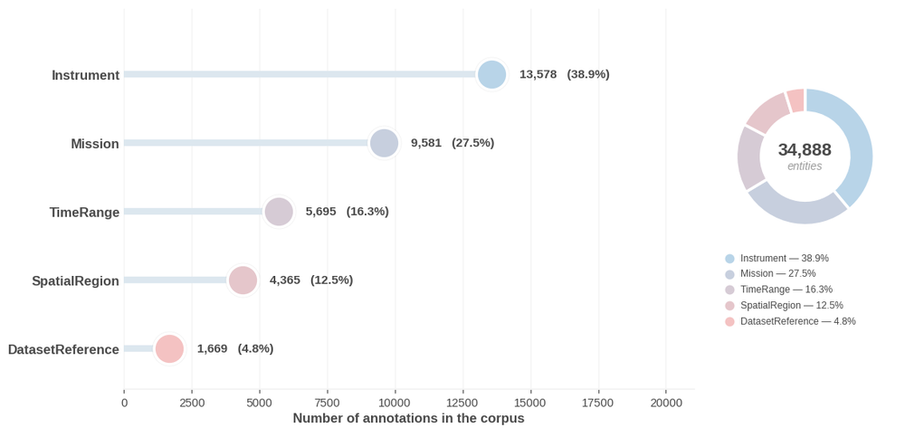
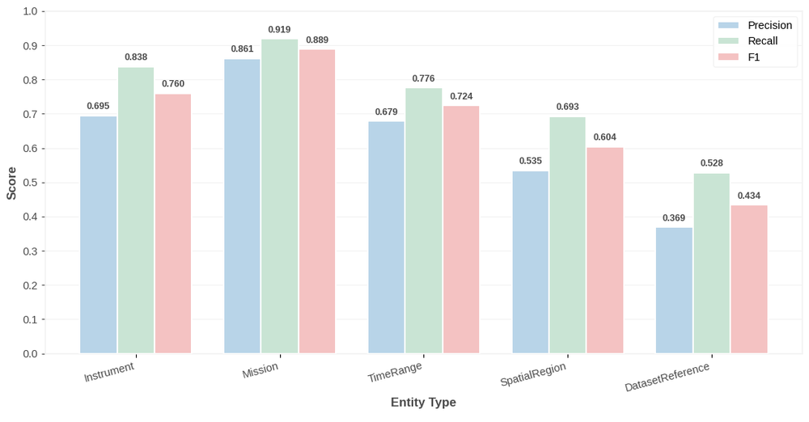
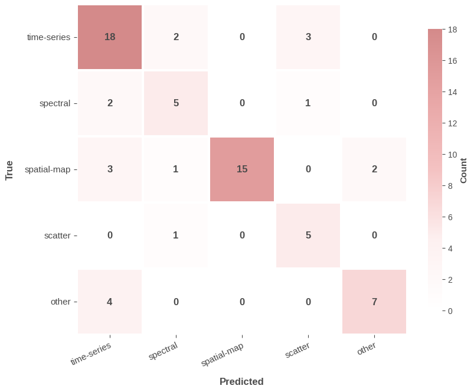
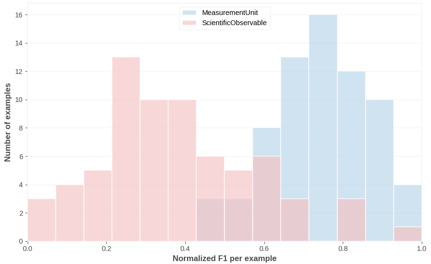

<div align="center">

# Heliophysics NER

**Information extraction from solar physics literature**

Named entity recognition with ModernBERT and figure-attribute generation with FLAN-T5


End-of-studies project (PFE), Polytech Monastir, 2025/2026
Supervised by Pr. Zrigui Mounir

</div>

---

## Overview

Solar physics papers contain a lot of structured knowledge (instruments, missions, observation periods, regions of the Sun, datasets), but it is buried in long PDFs. This project turns those papers into structured information that can be searched and analysed.

Two complementary models are used:

| Component | Approach | Rationale |
|---|---|---|
| Entity recognition | Extractive: token classification with ModernBERT | Entities are literal spans of text |
| Figure attributes | Generative: text-to-text with FLAN-T5-Large | Attributes often need normalization, not just copying |

## Pipeline

<div align="center">

</div>

## Dataset

A corpus of 102 solar physics papers, converted with Docling and annotated manually in Label Studio with a heliophysics-specific annotation scheme. It contains 34,888 entity annotations across five types, plus 672 annotated figure captions with three attributes each (`FigureType`, `MeasurementUnit`, `ScientificObservable`).

<div align="center">

</div>

The corpus and annotations are not included in this repository.

## Results

### Entity recognition

Entity-level evaluation on the test set (seqeval):

| Model | Macro F1 |
|---|---:|
| Rule-based baseline | 0.300 |
| SciBERT | 0.652 |
| **ModernBERT-base** | **0.682** |

<div align="center">

</div>

ModernBERT gains the most over SciBERT on long-context classes such as `Mission` and `DatasetReference`. The model supports up to 8,192 tokens; training here used 1,024-token windows (stride 128) to fit on a single Colab GPU.

### Figure attributes

FLAN-T5-Large, evaluated on a test set of 69 captions:

| Attribute | Metric | Score |
|---|---|---:|
| FigureType | Accuracy | **72.4%** |
| MeasurementUnit | Set F1 (normalized) | **0.715** |
| ScientificObservable | Set F1 (strict exact match) | **0.422** |

The model produced no invalid `FigureType` values on the test set.

<div align="center">

</div>

`ScientificObservable` is an open vocabulary: the annotations contain 868 distinct terms, 74% of which appear only once, and scoring is strict exact match. The per-example distribution below shows this: scores cluster near 0 for terms never seen in training and near 1 for terms reproduced exactly, while `MeasurementUnit`, a nearly closed vocabulary, is concentrated at high scores.

<div align="center">

</div>

## Repository structure

```
heliophysics-ner/
├── assets/                                  figures
├── notebooks/
│   ├── 01_modernbert_ner.ipynb              data preparation, training, evaluation (Colab)
│   └── 02_flan_t5_figure_attributes.ipynb   FLAN-T5 training and analysis (Kaggle)
├── requirements.txt
└── README.md
```

## Getting started

```bash
git clone https://github.com/USERNAME/heliophysics-ner.git
cd heliophysics-ner
pip install -r requirements.txt
```

Both notebooks are designed for a GPU runtime (Google Colab or Kaggle). Since the annotated data is not published, supply your own Label Studio export for the NER notebook (`entities_export.json`) and your own annotated captions for the FLAN-T5 notebook (set `DATA_FILE` at the top).

[](https://colab.research.google.com/github/USERNAME/heliophysics-ner/blob/main/notebooks/01_modernbert_ner.ipynb)

## Limitations

- Small corpus (102 papers) and a small figure test set (69 captions), so scores carry noticeable variance.
- A single train/validation/test split, without cross-validation.
- `ScientificObservable` is scored with strict exact match; a lenient or semantic metric would give higher scores.

## Tech stack

Python, PyTorch, Hugging Face Transformers and Datasets, seqeval, scikit-learn, Docling, Label Studio.

## Author

Senda LAATAOUI,

AI Researcher | Explainable AI & Medical Imaging | Deep Learning Engineer

[LinkedIn](https://www.linkedin.com/in/senda-laataoui/) 
